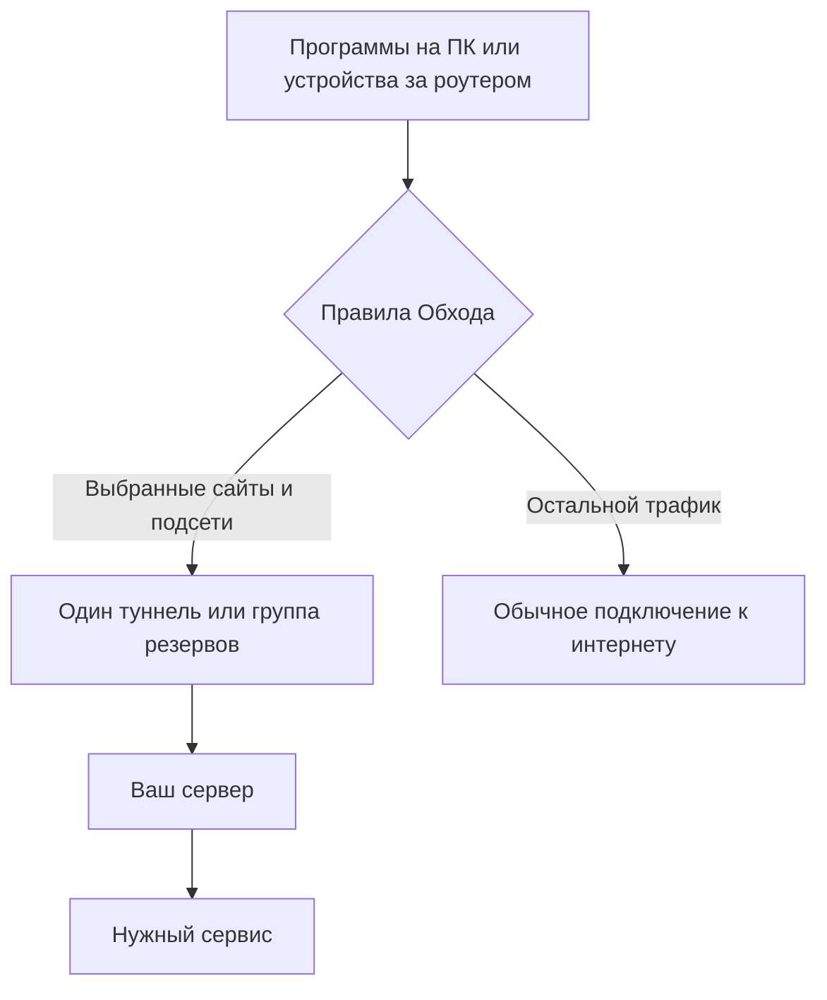
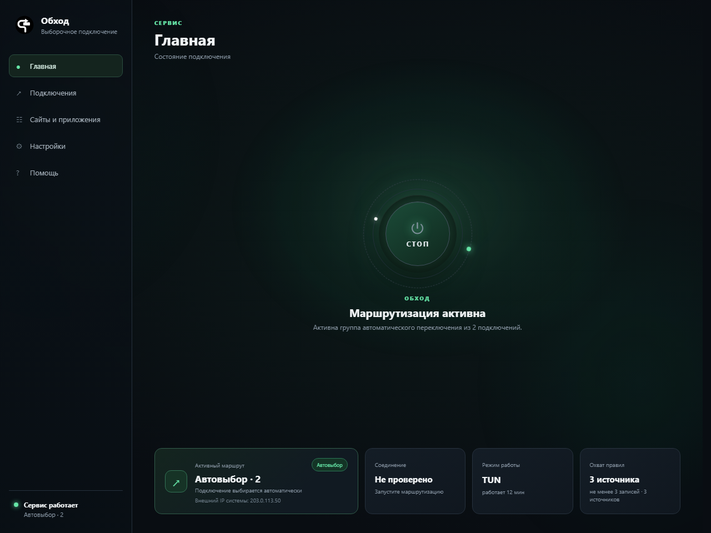
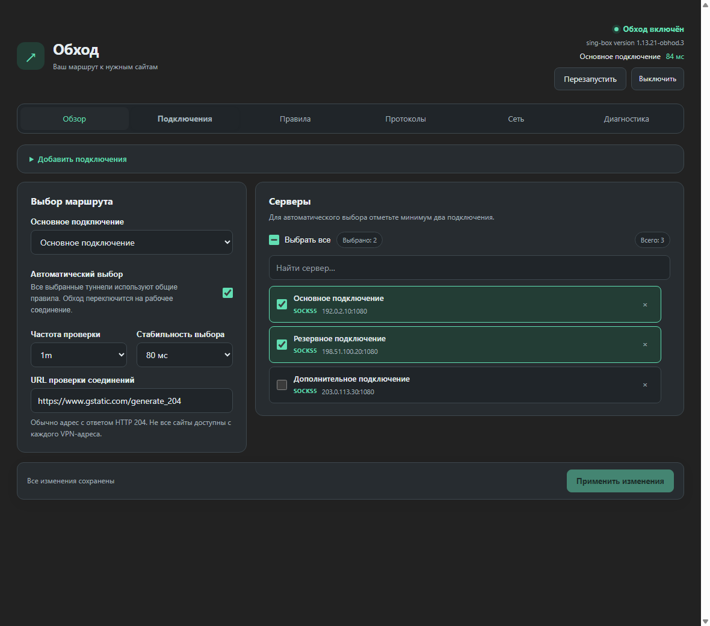

# Обход

**Выборочная маршрутизация для Windows и OpenWrt.** Обход направляет выбранные
сайты, подсети и, на Windows, программы через ваши подключения. Остальной трафик
сохраняет обычный маршрут. Несколько подключений можно объединить в резервную
группу с автоматическим выбором рабочего сервера.

Обход пригодится, когда рабочим сервисам нужен отдельный сетевой маршрут,
разным приложениям — разные условия подключения, а для повседневной работы
важно сохранить прямой доступ к остальному интернету и локальной сети.
Вы управляете правилами в одном интерфейсе и видите состояние выбранного маршрута.

| | Windows | OpenWrt |
| --- | --- | --- |
| Где работает | На отдельном компьютере | На роутере для устройств его локальной сети |
| Управление | Настольное приложение | LuCI → Службы → Обход |
| Правила | Домены, подсети, программы, готовые наборы | Домены, подсети, готовые наборы |
| Подключения | WireGuard, AmneziaWG и прокси-протоколы | WireGuard и прокси-протоколы; состав зависит от ядра |
| Начать | **[Установка и руководство Windows](windows/README.md)** | **[Установка и руководство OpenWrt](openwrt/README.md)** |
| Скачать | [Установщик Windows](https://github.com/Ktoto59/obhod-releases/releases/latest) | [Комплект OpenWrt](https://github.com/Ktoto59/obhod-releases/releases/tag/openwrt-v0.1.16) |

Обход использует **ваши** серверы: получите файл `.conf`, ссылку подключения
или V2Ray-подписку у своего провайдера либо администратора. Готовые аккаунты,
ключи и подписки в поставку не входят. Установка OpenWrt не требует установки
Windows-приложения; эти варианты настраиваются независимо.

## Как это работает



Все подключения группы используют **одни правила**. Автовыбор выбирает сервер
для новых соединений; он не складывает скорости нескольких серверов.
Смена сервера не гарантирует сохранения уже установленного звонка или загрузки.
Подробные схемы управления, трафика и DNS есть в руководствах обеих платформ.

## Windows: от установки до первого подключения

1. Скачайте `Obhod-Setup-<версия>.exe` со страницы
   [релизов Windows](https://github.com/Ktoto59/obhod-releases/releases/latest) и установите приложение.
2. В **Подключения** импортируйте `.conf` или нажмите **Вставить ссылку**.
3. В **Сайты и приложения** выберите готовые наборы или добавьте свои домены.
4. Сохраните настройки и включите маршрутизацию большой кнопкой на **Главной**.
5. Проверьте выбранный сайт и состояние соединения.



**[Полное руководство Windows →](windows/README.md)** — мастер первого запуска,
импорт подписки, TUN и прокси, свои списки, правила программ, DNS, резервирование,
обновление, перенос настроек и решение проблем.

## OpenWrt: настройка на роутере

Подключитесь к роутеру по SSH от `root`. Адрес берётся из вашей сети:
например, `ssh root@192.168.1.1`. Выполните:

```sh
wget -O /tmp/obhod-install.sh https://raw.githubusercontent.com/Ktoto59/obhod-releases/main/openwrt/install.sh && sh /tmp/obhod-install.sh
```

Установщик определит `apk` или `opkg`, покажет доступную память и предложит
выбрать ядро и начальные списки. Затем откройте **LuCI → Службы → Обход**,
добавьте подключение, задайте правила и нажмите **Сохранить и включить**.
Для работы через роутер клиентские устройства должны использовать его как шлюз
и DNS-сервер.



**[Полное руководство OpenWrt →](openwrt/README.md)** — совместимость и память,
установка с `apk`/`opkg`, выбор ядра, настройка LAN и FakeIP/DNS, списки,
обновление через LuCI, управление службой, диагностика и удаление.

Скриншоты показывают Windows **0.18.0** и OpenWrt **0.1.16** на демонстрационных
данных. Адреса серверов, подписка, IP и задержки на изображениях — примеры,
а не действующие подключения или результаты проверки домашней сети.
Оформление LuCI зависит от выбранной темы. OpenWrt выпускается как предварительная версия.

## Исходники и разработка

```text
windows/     Windows-приложение, ресурсы и руководство
openwrt/     Служба, LuCI, пакеты и руководство для роутеров
core/        Изменения совместимого ядра sing-box
shared/      Профили, импорт и генератор конфигурации обеих платформ
scripts/     Сборка, проверки и создание иллюстраций
test/        Модульные и интеграционные проверки
docs/        Общая документация и скриншоты
```

Нужны Node.js 22 или новее и npm. Из корня репозитория:

```sh
npm ci
npm test
npm run openwrt:core -- --check
```

Тесты без сетевого ядра запускаются и на Linux. Проверки с `sing-box.exe`
выполняются на Windows при наличии подготовленного ядра.

- [Разработка Windows](windows/README.md#разработка) и [подготовка ядра](windows/docs/BUILDING_RUNTIME.md).
- [Сборка и системные проверки OpenWrt](openwrt/docs/DEVELOPMENT.md).
- [Сборка совместимого ядра](core/README.md).
- [Создание скриншотов документации](docs/images/README.md).
- [Участие в разработке](CONTRIBUTING.md) и [сообщение об уязвимости](SECURITY.md).

## Распространение и лицензии

Здесь находятся исходники. Установщики и пакеты публикуются в
[obhod-releases](https://github.com/Ktoto59/obhod-releases); приложения получают
обновления из этого канала. Готовые наборы правил используют проект
[allow-domains](https://github.com/itdoginfo/allow-domains); устройство правил
вдохновлено [Podkop](https://github.com/itdoginfo/podkop).

Код приложения — **Apache License 2.0**; изменения сетевого ядра в
[core/overlay](core/README.md) — **GPL-3.0-or-later**. Сетевое ядро работает
отдельным процессом. См. [LICENSE](LICENSE),
[сторонние компоненты](THIRD_PARTY_NOTICES.md) и [лицензирование](docs/LICENSING.md).
