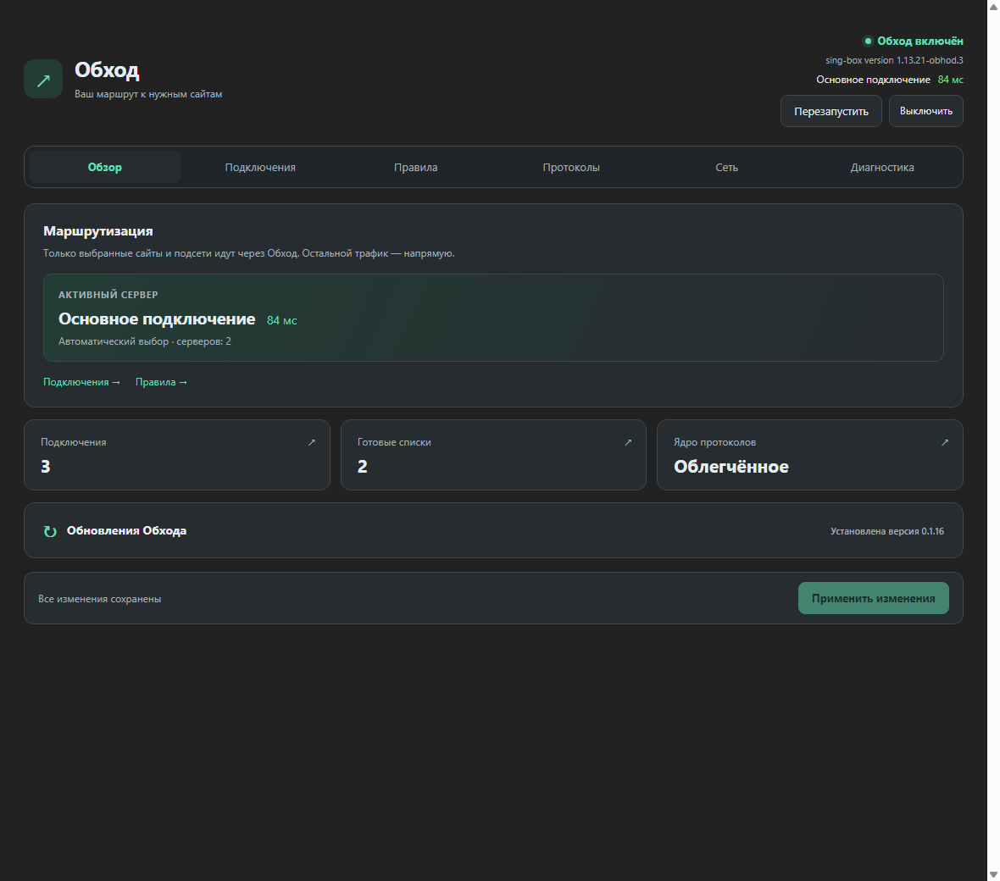
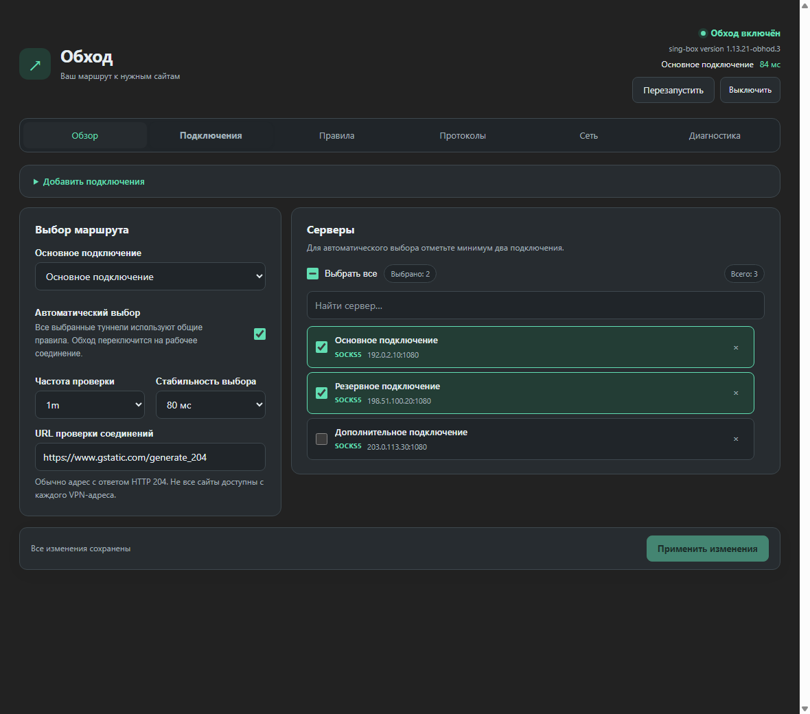
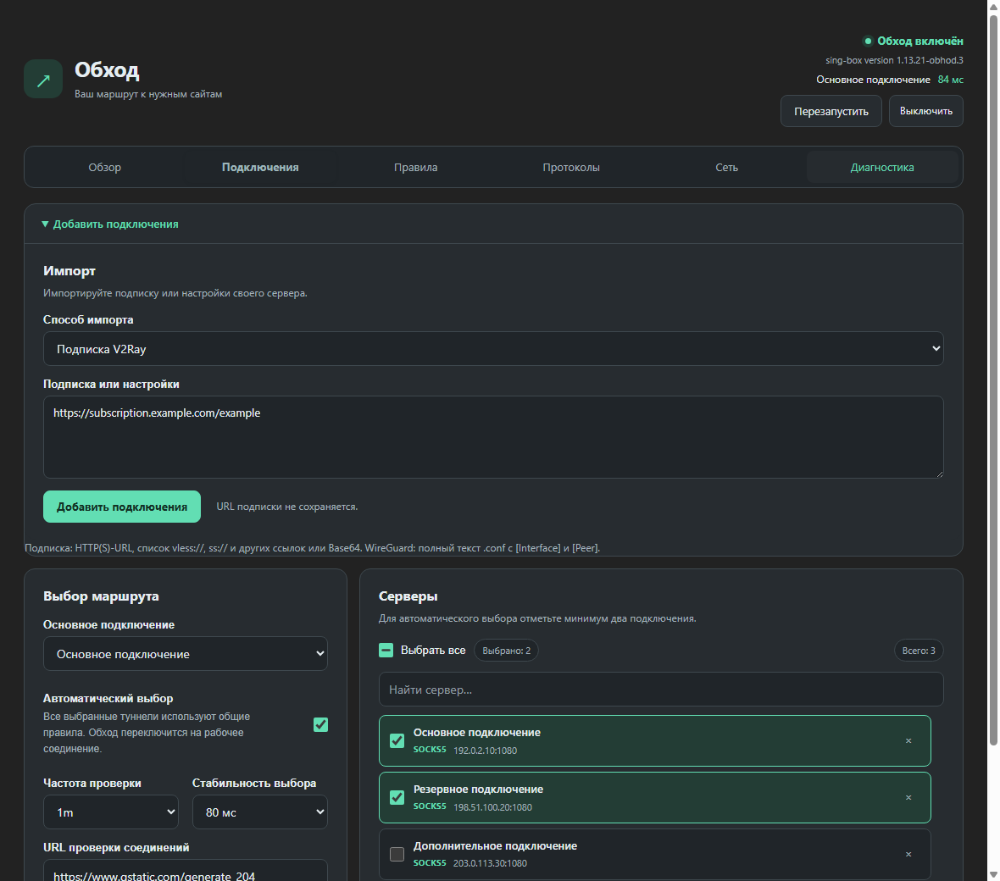
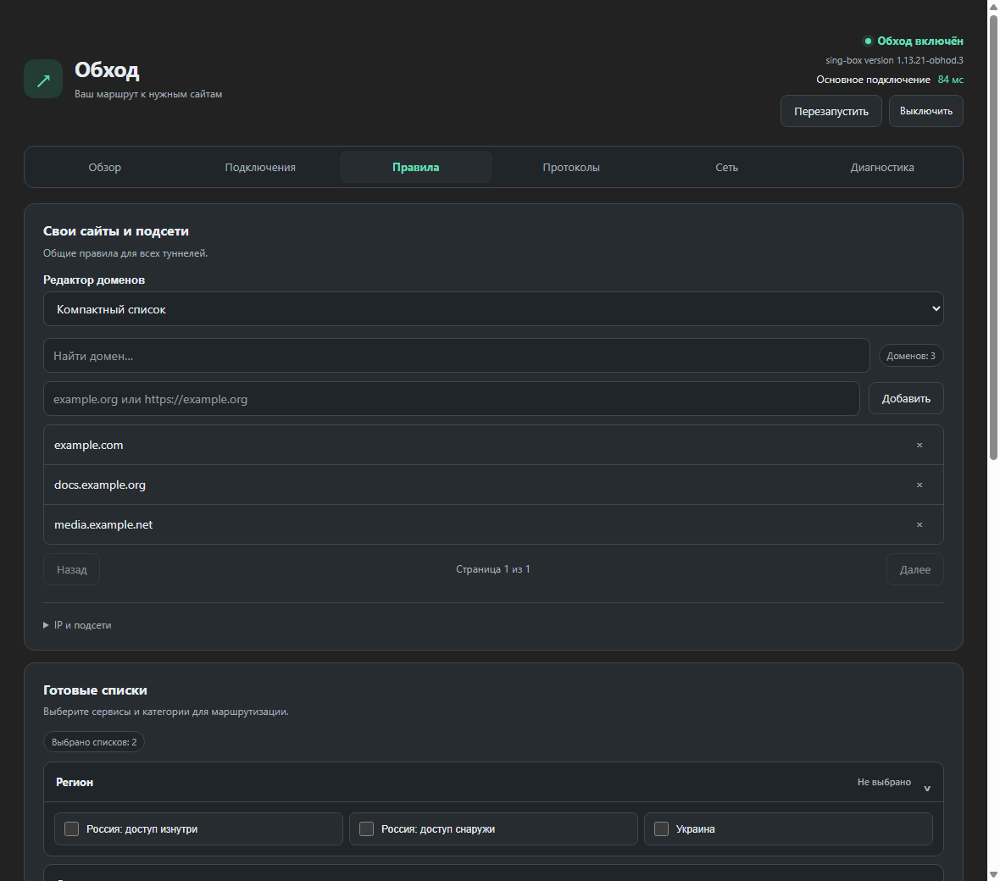
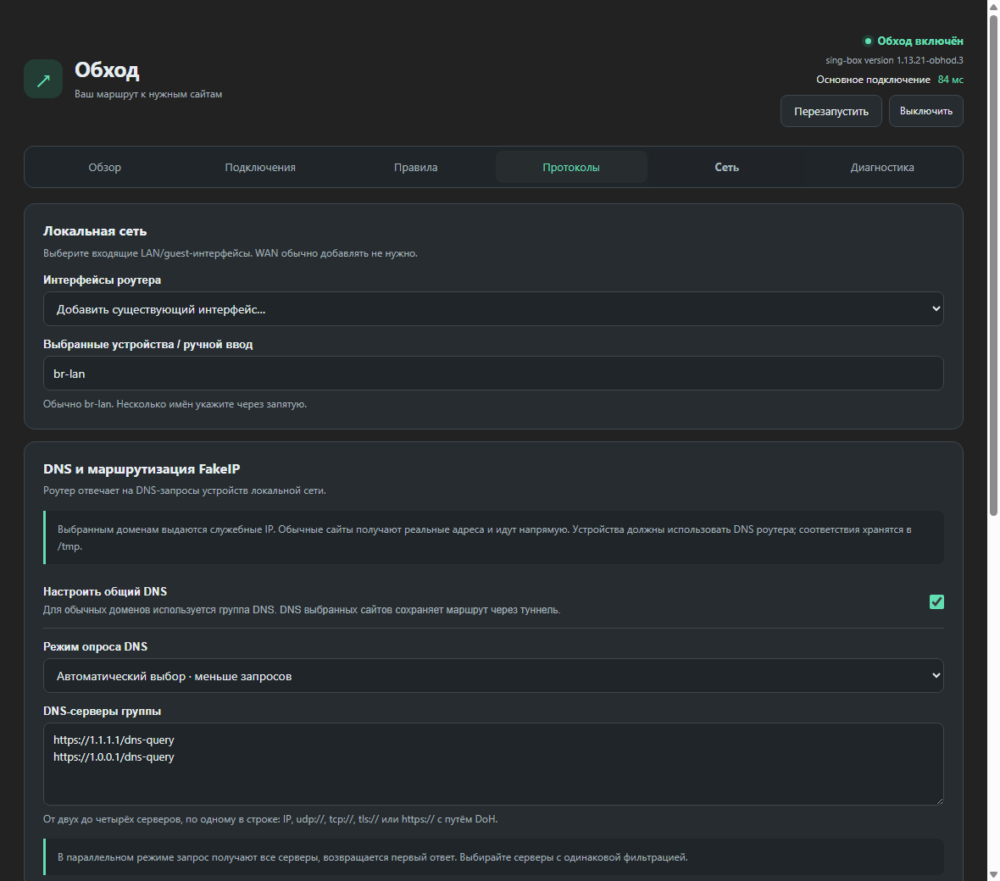
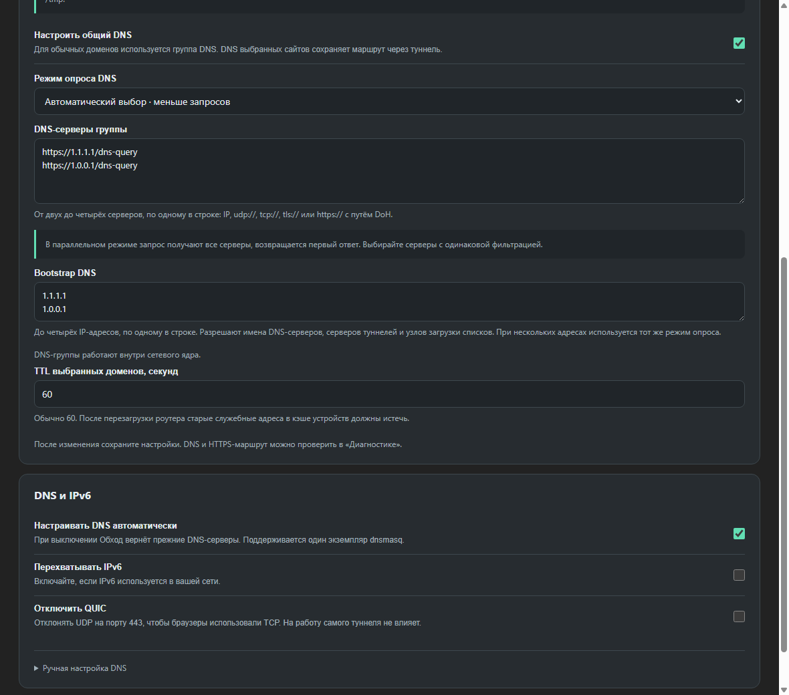
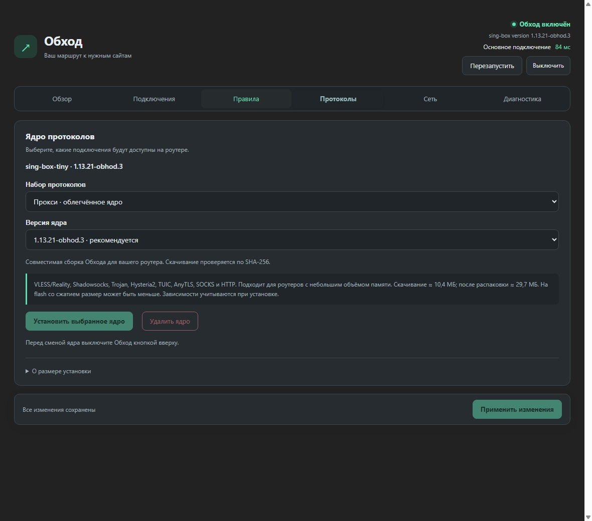
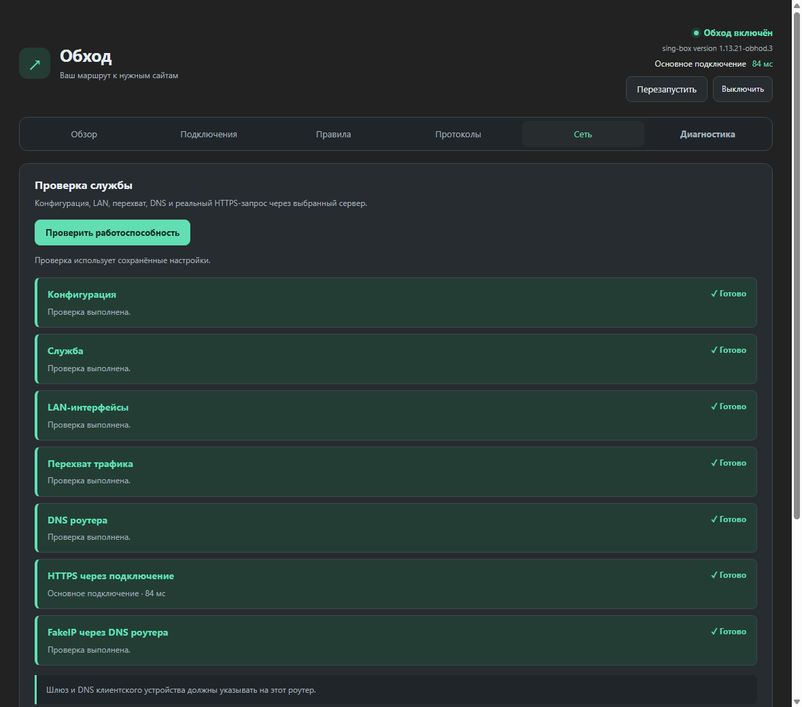
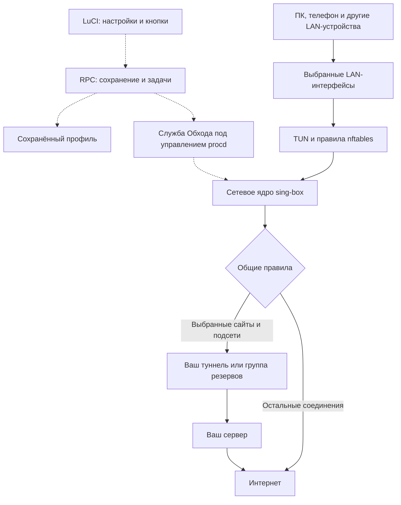
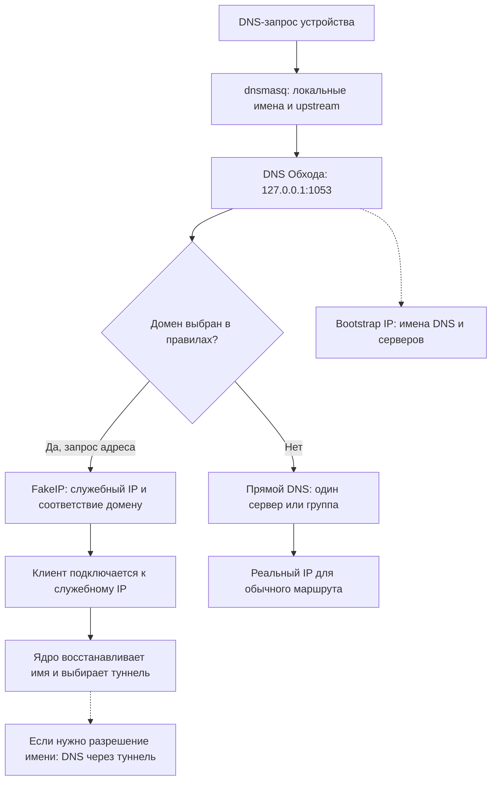

# Обход для OpenWrt

[← Главная документации](../README.md) · [Скачать комплект](https://github.com/Ktoto59/obhod-releases/releases/tag/openwrt-v0.1.16)

Служба Обход на роутере направляет выбранные сайты и подсети через ваши
подключения. Остальной трафик сохраняет прямой маршрут. Настройки задаются в
**LuCI → Службы → Обход** и применяются к устройствам выбранной локальной сети.
Windows-приложение на этих устройствах устанавливать не требуется.

Руководство соответствует **0.1.16** и ядру **1.13.21-obhod.3**. Версия OpenWrt
публикуется как предварительная. Скриншоты сняты с настоящего интерфейса LuCI
на демонстрационном профиле; серверы, IP и задержки — примеры. Тема LuCI может
выглядеть иначе. Готовые ключи, туннели и подписки в комплект не входят.



## Содержание

- [Совместимость и требования](#совместимость-и-требования)
- [Установка](#установка)
- [Первая настройка](#первая-настройка)
- [Подключения и резервные серверы](#подключения-и-резервные-серверы)
- [Домены, подсети и списки](#домены-подсети-и-списки)
- [Локальная сеть](#локальная-сеть)
- [DNS и FakeIP](#dns-и-fakeip)
- [Установка и обновление ядра](#установка-и-обновление-ядра)
- [Сохранение и управление службой](#сохранение-и-управление-службой)
- [Обновление Обхода](#обновление-обхода)
- [Диагностика и журнал](#диагностика-и-журнал)
- [Решение проблем](#решение-проблем)
- [Как устроена работа службы](#как-устроена-работа-службы)
- [Резервная копия](#резервная-копия)
- [Удаление](#удаление)
- [Сборка](#сборка)

## Совместимость и требования

| Компонент | Требование |
| --- | --- |
| Прошивка | OpenWrt 24.10 или 25.12; заводская прошивка не подходит |
| Установка | Доступ SSH от `root`, настроенный интернет и корректное время роутера |
| Интерфейс | LuCI; меню **Службы → Обход** |
| Пакетный менеджер | `opkg` и `.ipk` на 24.10; `apk` и `.apk` на 25.12, определяется автоматически |
| Сеть | firewall4/nftables и TUN; зависимости готовит установщик |
| Ядро протоколов | Совместимый sing-box 1.12+; состав протоколов зависит от сборки |
| ОЗУ | Для начала рекомендуется 128 МБ и больше; расход зависит от списков и группы серверов |

Пакеты службы и LuCI не зависят от архитектуры процессора. **Сетевое ядро зависит.**
Совместимые сборки Обхода доступны для `aarch64_cortex-a53` и `mipsel_24kc`
на 24.10/25.12. Это, например, устройства семейств Filogic и MT7621.
Модель роутера сама по себе не гарантирует совместимость: важны target,
архитектура пакетов, версия OpenWrt и ядро Linux.

На других архитектурах и SNAPSHOT установщик использует доступные штатные пакеты
OpenWrt; нужная версия и функции должны присутствовать в репозитории прошивки.
Подробнее: [совместимое сетевое ядро](../core/README.md).

### Сколько места нужно

Установщик показывает отдельно ОЗУ, свободное место `/overlay` и `/tmp`.
`/tmp` находится в оперативной памяти и не увеличивает свободное место flash.
Заполненный `/rom` в squashfs-прошивке — обычное состояние; для установки важен
доступный объём `/overlay` или корневой записываемой файловой системы.

Для подготовки нужны минимум 1 МБ в `/tmp` и 2 МБ flash. Крупные зависимости
требуют предварительно не менее 15 МБ свободного flash. Это начальная проверка,
а не обещание, что любой комплект поместится ровно в 15 МБ.
Размер ядра зависит от архитектуры и сборки; LuCI показывает объём скачивания
и размер после распаковки для выбранной версии. Сжатая flash и установленный
пакет могут занимать меньше распакованного размера. При обновлении может
потребоваться дополнительное место рядом со старым ядром.

ОЗУ не является жёстким порогом установки: при малом объёме выводится
предупреждение. Для слабого роутера начните с облегчённого ядра, нескольких
подключений и минимального числа списков.

## Установка

### 1. Подключиться к роутеру

На компьютере откройте терминал или PowerShell:

```sh
ssh root@192.168.1.1
```

Замените адрес на адрес **своего** роутера. Если SSH использует другой порт,
укажите его: `ssh -p 2222 root@192.168.1.1`. Пароль вводится в запросе SSH.
Установка OpenWrt или смена прошивки в этот сценарий не входят.

### 2. Запустить установщик

Рекомендуемый переносимый вариант:

```sh
wget -O /tmp/obhod-install.sh https://raw.githubusercontent.com/Ktoto59/obhod-releases/main/openwrt/install.sh && sh /tmp/obhod-install.sh
```

Если оболочка поддерживает подстановку процесса, доступна короткая форма:

```sh
sh <(wget -O - https://raw.githubusercontent.com/Ktoto59/obhod-releases/main/openwrt/install.sh)
```

Установщик проверяет OpenWrt и место, скачивает закреплённый комплект,
проверяет SHA-256, подготавливает зависимости и предлагает два выбора:

| Выбор | Что означает |
| --- | --- |
| **Прокси** | Облегчённое ядро: VLESS/Reality, Shadowsocks, Trojan, Hysteria2, TUIC, AnyTLS, SOCKS/HTTP |
| **WireGuard / все поддерживаемые** | Полное ядро, в котором доступны также прокси |
| **Выбрать позже в LuCI** | Установка службы и интерфейса; ядро установите во вкладке «Протоколы» |
| **Минимальные списки** | Discord, Telegram, Google AI |
| **Рекомендуемые списки** | Региональный набор `russia_inside`, Discord, Meta, Telegram, Google AI |
| **Выбор по номерам / без списков** | Свой начальный состав правил |

При облегчённой установке начальным вариантом служит минимальный набор.
Состав можно изменить позже. Существующий профиль не перезаписывается.
При уже установленном ядре установщик старается сохранить его вариант;
явная смена выполняется через LuCI.

### 3. Открыть LuCI

Откройте веб-интерфейс своего роутера, войдите и выберите **Службы → Обход**.
Если пункт не появился, обновите страницу или войдите повторно.
После чистой установки служба **выключена** до добавления подключения и запуска.

### Установка без прямого скачивания комплекта на роутере

Скачайте `obhod-openwrt-0.1.16.tar.gz` и `SHA256SUMS` из
[одного релиза](https://github.com/Ktoto59/obhod-releases/releases/tag/openwrt-v0.1.16).
Проверьте хеш архива по опубликованному файлу и скопируйте архив на роутер в `/tmp`.
Для OpenSSH-клиента и роутера без SFTP можно использовать SCP-режим:

```sh
scp -O obhod-openwrt-0.1.16.tar.gz root@192.168.1.1:/tmp/
```

В терминале **роутера** выполните:

```sh
mkdir -p /tmp/obhod-install
tar -xzf /tmp/obhod-openwrt-0.1.16.tar.gz -C /tmp/obhod-install
sh /tmp/obhod-install/install.sh
```

Это исключает скачивание самого комплекта установщиком, но для недостающих
зависимостей и ядра всё ещё может понадобиться доступ к репозиториям.

### Предварительная проверка и автоматизация

После скачивания установщика:

```sh
sh /tmp/obhod-install.sh --check-only --protocols proxy --presets minimal
sh /tmp/obhod-install.sh --yes --protocols proxy --presets minimal
```

Первая команда не устанавливает пакеты и не записывает профиль; может загружать
комплект и обновлять индексы пакетов в `/tmp`. Вторая устанавливает выбранный
вариант без интерактивного меню. Справка: `sh /tmp/obhod-install.sh --help`.

## Первая настройка

После установки пройдите по вкладкам:

1. **Протоколы:** убедитесь, что ядро установлено; при необходимости установите его.
2. **Подключения:** импортируйте свои данные и выберите основной сервер.
3. **Правила:** задайте свои домены/подсети и нужные готовые наборы.
4. **Сеть:** проверьте входящий LAN-интерфейс и автоматическое управление DNS.
5. Нажмите **Сохранить и включить**.
6. В **Диагностика** нажмите **Проверить работоспособность**.
7. На клиенте, подключённом к этому роутеру, откройте выбранный сайт и обычный
   сайт, который не добавляли в правила.

Все туннели используют **одни общие правила**. Отдельных разделов правил на
каждый сервер создавать не нужно. Для первого запуска удобнее один проверенный
сервер; резервные подключения добавьте после проверки основного.

## Подключения и резервные серверы



### Импорт

1. Откройте **Подключения → Добавить подключения**.
2. Выберите тип импорта.
3. Вставьте ссылку подключения, URL V2Ray-подписки, список ссылок,
   Base64-представление списка или текст WireGuard `.conf` в соответствии с выбранным типом.
4. Нажмите **Добавить подключения**.
5. Выберите **Основное подключение** и сохраните настройки.



Подписку скачивает роутер. URL не сохраняется; для обновления серверов повторите
импорт вручную. Дубликаты пропускаются. Неподдерживаемые записи отменяют импорт
всего набора. Импорт VMess и целых конфигураций JSON/YAML не поддерживается.
Подписка ограничена 128 КБ; слишком большой список лучше сократить у источника.
Удаление карточки или добавление серверов становится постоянным после сохранения.

### Автоматический выбор

1. Добавьте минимум два рабочих подключения.
2. Включите **Автоматический выбор** и отметьте серверы группы.
3. Используйте поиск или **Выбрать все**, если список большой.
4. Задайте частоту проверки, стабильность выбора и URL проверки.
5. Примените изменения.

Проверяется реальный HTTPS-запрос, а не только ICMP ping. Допуск 80 мс уменьшает
переключения из-за небольших изменений задержки. Слишком большая группа создаёт
больше проверок; на роутере с небольшой ОЗУ начните с нескольких серверов.

Для одного фиксированного сервера **выключите автоматический выбор** и задайте
основное подключение. Выбор строки сервера сам по себе не отключает группу.
Переключение не объединяет пропускную способность серверов и не гарантирует
бесшовного переноса уже установленного звонка между ними.

## Домены, подсети и списки

Откройте вкладку **Правила**.



### Свои домены

Введите домен в поле добавления и нажмите кнопку добавления. Для большого
набора выберите текстовый режим и вставьте адреса по одному в строке:

```text
example.com
docs.example.org
media.example.net
```

Можно вставить URL страницы: сохранится домен. Правило охватывает домен и его
поддомены; пути `/page`, протоколы и `*.example.com` для записи домена не нужны.
В режиме списка доступны поиск, удаление и страницы по 50 записей.
После правок примените изменения общей нижней кнопкой.

### IP и подсети

Вставьте отдельным списком в поле **IP и подсети**, например:

```text
203.0.113.10/32
198.51.100.0/24
```

Примеры используют зарезервированные адреса: замените их адресами нужных сервисов.
Одно IP-правило может охватить несколько сайтов, использующих общий адрес.
Правил отдельных `.exe` на роутере нет: это функция Windows-версии.

### Готовые наборы

Раскройте группы **Регион**, **Сервисы**, **Категории** или **Сети** и отметьте
нужное. Несовместимые региональные наборы не выбираются одновременно.
Некоторые крупные наборы уже включают отдельные сервисы, поэтому их флажки
могут быть недоступны. Примените изменения.

### Внешние списки

В поле внешних списков укажите HTTPS-ссылки **на содержимое** `.srs` или `.json`,
по одной в строке. Страница GitHub с просмотром файла вместо raw-файла не подходит.

- `.srs` — бинарный rule-set sing-box совместимой версии.
- `.json` — исходный rule-set sing-box, а не экспорт настроек другого приложения.
- Обычный `.txt`, hosts-файл и список фильтров Adblock через это поле не импортируются.
  Для короткого текста используйте свои домены/подсети.

Минимальный пример содержимого JSON:

```json
{
  "version": 3,
  "rules": [{ "domain_suffix": ["example.com", "example.org"] }]
}
```

Текущий интерфейс рассматривает внешние списки как доменные. Подсети задавайте
в отдельном поле; отдельного переключателя типа внешнего списка в LuCI нет.
Интервал обновления и загрузка списков через активный туннель задаются здесь же.
При загрузке через туннель его доступность нужна и для обновления списков.

## Локальная сеть

Откройте **Сеть → Локальная сеть**.



В выпадающем списке добавьте входящие интерфейсы, например `br-lan`.
Для гостевой сети можно добавить её отдельное устройство, если доступ разрешён
сетевыми правилами. Ручной ввод остаётся доступным; несколько имён разделяются запятыми.
Нужны имена устройств Linux, а не произвольное название сети. WAN и `lo` сюда не добавляйте.

На клиентских устройствах **шлюз и DNS должны указывать на этот роутер**.
Обычно это обеспечивает DHCP. Если Обход стоит на дополнительном роутере,
но ПК выходит через другой шлюз, включение службы на дополнительном устройстве
не изменит маршрут этого ПК.

Встроенный защищённый DNS браузера, Private DNS телефона или другой VPN могут
использовать свой способ разрешения имён. Для первой проверки используйте DNS
роутера и отключите другие VPN на проверяемом клиенте.
Перехват IPv6 включайте, когда он настроен в вашей сети и нужен клиентам;
проверьте отдельно IPv4- и IPv6-подключения.

## DNS и FakeIP

Обход использует FakeIP для выбранных доменов: клиент получает служебный адрес,
а ядро сохраняет соответствие с исходным доменным именем. При соединении оно
направляет трафик по доменному правилу через выбранный туннель. Обычные сайты
получают реальные адреса и сохраняют прямой маршрут.

Это не отдельный режим шифрования и не глобальная подмена адресов всех сайтов.
Адрес вида `198.18.x.x` для выбранного домена — ожидаемый ответ FakeIP.

### Автоматическое управление DNS

Оставьте включённым управление DNS, если не настраиваете цепочку DNS вручную.
Служба сохраняет исходные настройки upstream dnsmasq, направляет его запросы
на локальный порт Обхода и при штатной остановке восстанавливает прежние значения.
Автоматический режим рассчитан на **один экземпляр dnsmasq**.

При ручной настройке используйте upstream dnsmasq `127.0.0.1#1053` и обеспечьте
его корректное восстановление самостоятельно. Не настраивайте циклическую
цепочку, в которой Обход и другой DNS-сервис отправляют запросы друг другу.
Порт 1053 — внутренний upstream, а не DNS-порт для ввода на телефоне: клиенту
указывается LAN-адрес роутера с обычным DNS-портом 53.

### Выбор DNS-серверов

Включите **Настроить общий DNS** и выберите режим:

| Режим | Поведение |
| --- | --- |
| **Один сервер** | Настройки одного резолвера: готовый профиль или свой адрес и протокол |
| **Автоматический выбор** | Предпочитает известный рабочий сервер; при задержке добавляет резерв |
| **Параллельный опрос** | Отправляет запрос участникам группы и использует первый успешный ответ |

Для группы укажите 2–4 сервера, по одному в строке. Например, два узла одного провайдера:

```text
https://1.1.1.1/dns-query
https://1.0.0.1/dns-query
```



Поддерживаются IP без префикса (UDP), `udp://`, `tcp://`, `tls://` и `https://`
с корректным путём DoH. Примеры формата: `tcp://8.8.8.8:53`, `tls://dns.google`.
Используйте значения из документации своего DNS-провайдера; указанные адреса
демонстрируют формат, а не гарантируют доступность в любой сети.

Выбирайте участников с одинаковой политикой фильтрации. Если один сервер
блокирует рекламу, а второй разрешает её, результат может различаться:
NOERROR/NXDOMAIN могут завершить опрос, а REFUSED/SERVFAIL не мешают получить
успешный ответ другого участника. Группа не объединяет правила фильтрации провайдеров.

### Bootstrap и TTL

В **Bootstrap DNS** можно указать до четырёх IP-адресов, по одному в строке.
Они нужны для начального разрешения имён DNS-серверов, серверов туннелей
и инфраструктуры загрузки списков. Bootstrap и основной DNS выполняют разные
задачи; их адреса не обязаны совпадать. URL в поле bootstrap не используется.

TTL выбранных доменов по умолчанию 60 секунд. Соответствия FakeIP хранятся
в ОЗУ и сохраняются при штатном перезапуске службы, но не после перезагрузки роутера.
После полной перезагрузки или смены правил клиенту может потребоваться обновить
DNS-кэш и создать новое соединение.

В совместимом ядре DNS-группы работают внутри sing-box. Со штатным ядром
при первом использовании группы может понадобиться кнопка **Подготовить DNS-группы**:
она установит `ucode-mod-socket` из репозитория OpenWrt. После завершения примените настройки.
Локальные группы для обычного DNS и DNS через туннель разделены.

## Установка и обновление ядра

Вкладка **Протоколы** управляет сетевым ядром, а не отдельными аккаунтами.



1. Выключите службу кнопкой **Выключить** в шапке.
2. Выберите **Набор протоколов**: облегчённое или полное ядро.
3. Выберите **Версию ядра**, доступную для вашего устройства.
4. Посмотрите размер скачивания и после распаковки.
5. Нажмите **Установить выбранное ядро** и дождитесь завершения.
6. Сохраните изменённые настройки, если они есть, и включите Обход.

Облегчённое ядро называется пакетом `sing-box-tiny`, полное — `sing-box`.
Оба используют исполняемый файл `/usr/bin/sing-box`. Это **один установленный
бинарник**, а не дополнительная копия из-за имени файла. Путь
`/overlay/upper/usr/bin/sing-box` может показывать ту же запись через overlayfs.
Выбор одного VLESS не вырезает остальные функции из общей сборки.
Для WireGuard нужно полное ядро; AmneziaWG в текущем пакете OpenWrt не поддерживается.

Совместимое ядро `1.13.21-obhod.3` включает исправления таблиц маршрутизации
на 32-битных MIPS и изменений DNS/UDP. Для поддерживаемых платформ в списке
есть рекомендованная сборка и предыдущая версия для отката. На остальных
используется доступный пакет OpenWrt. Размеры зависят от платформы и версии.

**Удалить ядро** удаляет пакет после подтверждения, сохраняя подключения и правила.
Служба должна быть выключена. Если ядро нужно другому пакету, принудительное
удаление не выполняется. При переходе с полного ядра на tiny сначала удалите
WireGuard-подключения из профиля и сохраните изменения.
Не удаляйте бинарник вручную: пакетный менеджер должен учитывать состояние установки.

## Сохранение и управление службой

| Кнопка | Действие |
| --- | --- |
| **Сохранить** | Сохраняет профиль при выключенной службе |
| **Сохранить и включить** | Сохраняет профиль и запускает маршрутизацию |
| **Применить изменения** | Сохраняет и применяет настройки работающей службы |
| **Отменить** | Возвращает черновик к последним сохранённым настройкам, включая импорт и удаления |
| **Выключить** | Останавливает службу и запускает восстановление управляемого DNS |
| **Включить** | Запускает службу с сохранёнными настройками |
| **Перезапустить** | Перезапускает с сохранённым профилем; несохранённый черновик не применяет |

Переключение вкладок не теряет черновик. Применение конфигурации и перезапуск
могут прервать активные соединения. Установка ядра и обновление выполняются
отдельными задачами; не запускайте одновременно несколько операций с пакетами.
Состояние и сообщение об операции отображаются в интерфейсе.

## Обновление Обхода

1. Сохраните черновик; при необходимости сделайте резервную копию.
2. Откройте **Обзор → Обновления Обхода**.
3. Нажмите **Проверить обновления**, затем **Обновить Обход**.
4. Дождитесь завершения и нажмите **Открыть новую версию** либо обновите страницу.

Обновляются пакеты `obhod` и `luci-app-obhod`. **Сетевое ядро обновляется отдельно**
во вкладке **Протоколы**, с сохранением нужного набора — полного или облегчённого.
Подключения и правила сохраняются. Если служба работала, на время обновления
она остановится и затем будет запущена снова. Архив проверяется по SHA-256.

Обновление через LuCI доступно с 0.1.5. Для более ранних версий один раз запустите
обычный установщик. Если проверка обновления не работает, проверьте DNS,
время роутера и доступ к GitHub; при необходимости используйте установщик
или перенос комплекта с ПК. Не отключайте проверку HTTPS для исправления ошибки времени.

## Диагностика и журнал

Откройте **Диагностика → Проверить работоспособность**.



Проверяются конфигурация, работа службы, LAN-устройства, перехват TUN/nftables,
DNS роутера, HTTPS через выбранный сервер и FakeIP. Зелёная карточка означает
успешный результат конкретной проверки, красная — проблему в ней.
Проверка использует **сохранённые** настройки.

Диагностика на роутере не проверяет, какой шлюз/DNS использует телефон или ПК,
и не заменяет проверку UDP-звонка. Активный сервер и задержка HTTPS также
показываются в шапке и обзоре.

В журнале доступны **Обновить** и **Очистить**. Журнал службы ограничен примерно
32 КБ и находится в ОЗУ, поэтому не заполняет flash. Старые записи вытесняются,
после перезагрузки устройства журнал пропадает. Подробную запись включайте
в диагностических настройках на время поиска проблемы. Перед публикацией
логов и профилей проверьте, нет ли в них чувствительных данных.

Полезные команды только для просмотра, выполняются на роутере:

```sh
date
ubus call system board
ubus call obhod status '{}'
ubus call service list '{"name":"obhod"}'
df -h
free -m
logread -e obhod
tail -n 80 /var/run/obhod/service.log
```

`ubus call obhod status` содержит название выбранного сервера; файл
`/etc/obhod/settings.json` содержит секреты подключений и не предназначен
для публичной отправки целиком.

## Решение проблем

| Симптом | Что проверить |
| --- | --- |
| Нет пункта Обход в LuCI | Установку обоих пакетов, обновление страницы и повторный вход |
| Служба не включается | Наличие ядра, сохранённого подключения и сообщение диагностики; другой активный менеджер маршрутизации |
| «Другая операция выполняется» | Ход установки/обновления, работающие apk/opkg и журнал; не удаляйте lock вслепую во время установки |
| Сайт показывает прежний внешний IP | Сохранённое правило для точного домена, шлюз и DNS клиента, другой VPN/DoH, новое соединение браузера |
| 2ip.io добавлен, а 2ip.ru идёт иначе | Это разные домены; добавьте именно тот, который открываете |
| Получен адрес 198.18.x.x | Для выбранного домена это FakeIP; проверьте последующее соединение и диагностику |
| После включения ничего не открывается | DNS роутера, доступность upstream и bootstrap, корректность LAN-интерфейса |
| HTTPS работает, звонок обрывается | UDP через выбранный протокол/сервер, качество Wi-Fi и смены маршрута; тест HTTPS не подтверждает исправность UDP |
| Не хватает места при обновлении ядра | Свободный `/overlay`, размер пакета и дополнительное место замены; не путайте с `/tmp` и `/rom` |
| После смены DNS результат не изменился сразу | DNS-кэш клиента, уже открытые соединения и собственный DNS браузера |
| Не скачивается подписка/обновление | Время, DNS, HTTPS-доступ к источнику, размер подписки и доступность сайта |

При сообщении о проблеме укажите модель, версию OpenWrt, Обхода и ядра,
используемый протокол, время события с часовым поясом и результаты диагностики.
Пароли, ключи, UUID и полную подписку публиковать не нужно.

## Как устроена работа службы

Первая схема разделяет управление и передачу трафика. Пунктир — управление;
сплошные стрелки — путь соединений.



Вторая схема показывает доменные запросы. Запрос и последующее подключение —
разные этапы. Bootstrap обслуживает начальное разрешение имён инфраструктуры.



DNS-группы совместимого ядра работают внутри sing-box; со штатным ядром могут
работать локальные ucode-помощники. Обход готовит настройки и управляет жизненным
циклом, а ядро обрабатывает трафик. Одна группа резервов использует один набор правил.

## Резервная копия

Копия OpenWrt — это файлы роутера, а не Windows-файл `.obhod`.
Для сохранения профиля и настроек службы выполните на роутере:

```sh
tar -czf /tmp/obhod-backup.tar.gz /etc/obhod /etc/config/obhod
```

Скопируйте архив на ПК, например из терминала компьютера:

```sh
scp -O root@192.168.1.1:/tmp/obhod-backup.tar.gz .
```

Архив содержит секреты и **не зашифрован**: храните его как конфиденциальный файл.
`/tmp` очищается при перезагрузке, поэтому оставленная там копия не является надёжным хранением.

Для восстановления на том же устройстве/совместимой установке сначала
выключите Обход через LuCI, сохраните текущие файлы отдельно и распакуйте архив
во временную папку. Верните сохранённый `settings.json` и при наличии
`defaults.json` в `/etc/obhod`, сохраните права доступа только для root.
Файл `dns-backup.json` из старого устройства не переносите: он относится к его
настройкам dnsmasq. На новом устройстве проверьте LAN-интерфейсы, DNS и тип ядра,
затем сохраните и запустите через LuCI. Полное восстановление конфигурации роутера
выполняйте средствами резервного копирования самой OpenWrt.

## Удаление

1. Нажмите **Выключить** в LuCI и убедитесь, что DNS восстановлен.
2. Если хотите удалить и ядро, используйте **Протоколы → Удалить ядро**.
3. Удалите приложение через пакетный менеджер своей прошивки:

```sh
# OpenWrt 25.12
apk del luci-app-obhod obhod
```

```sh
# OpenWrt 24.10
opkg remove luci-app-obhod obhod
```

Настройки в `/etc/obhod` могут остаться для повторной установки. До их удаления
сделайте копию и убедитесь, что не остались невосстановленные настройки DNS.
Не удаляйте общие сетевые зависимости, если они используются другими службами.

## Сборка

Для обычной установки сборка исходников не нужна.
[Отдельная инструкция разработчика](docs/DEVELOPMENT.md) описывает SDK/пакеты,
системные проверки, LuCI и работу с тестовым rootfs. Общие генераторы находятся
в [`shared/`](../shared/), изменения ядра — в [`core/`](../core/README.md).
