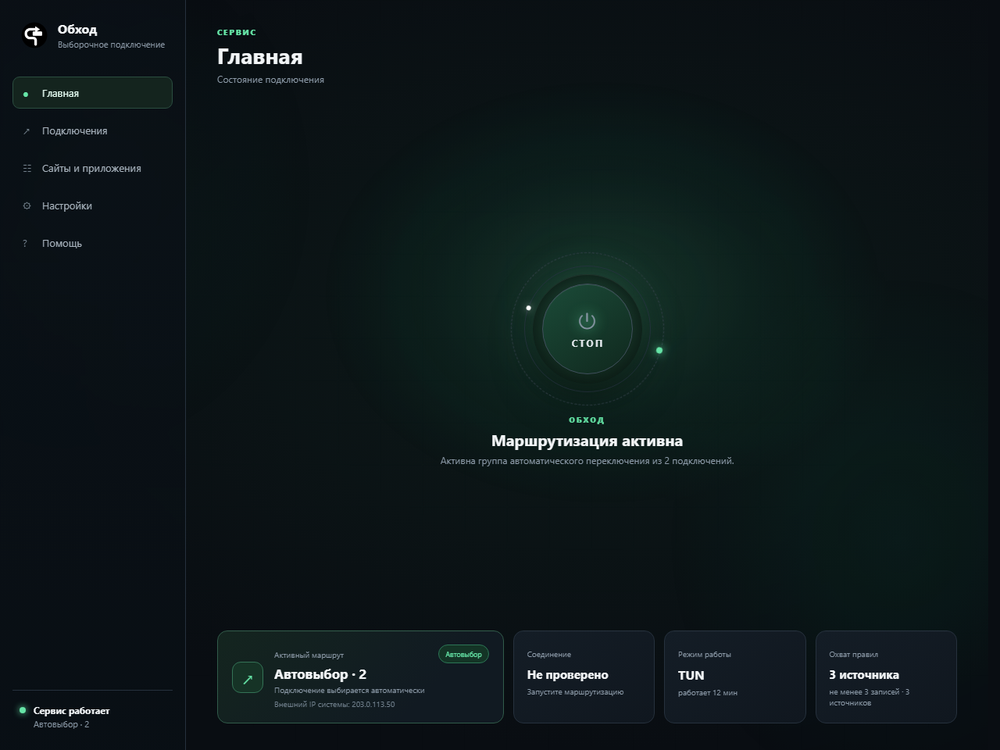
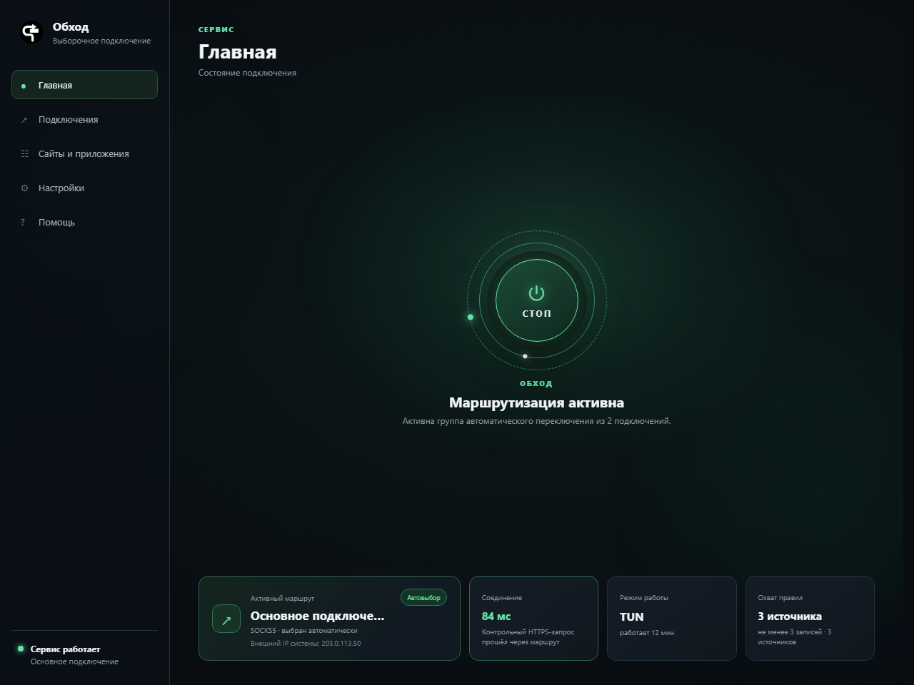
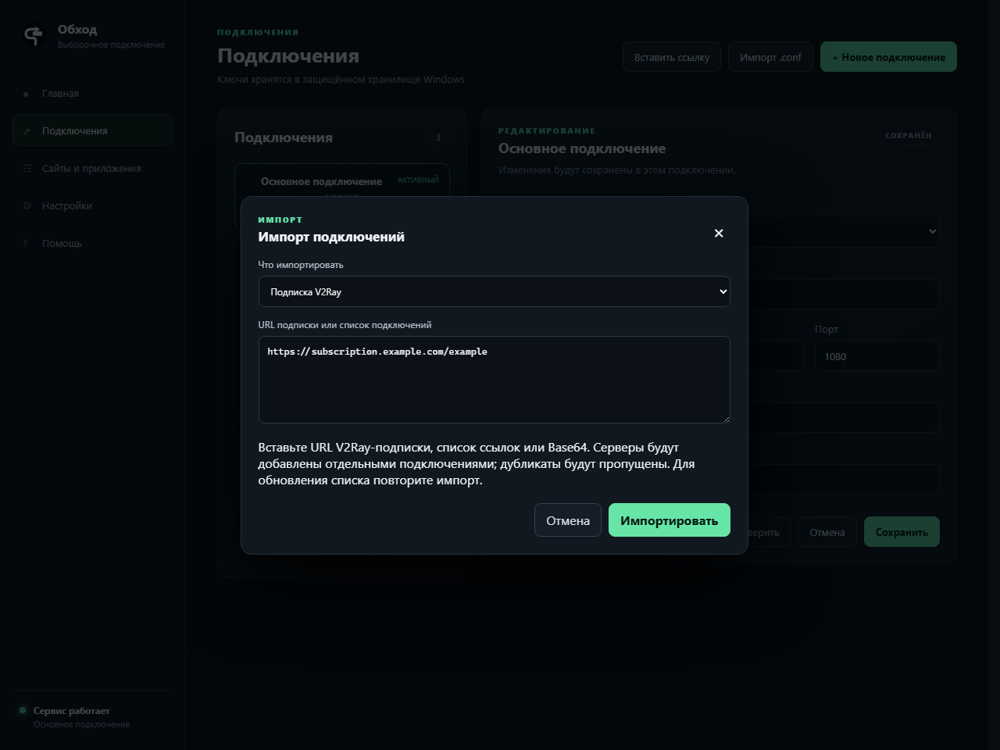
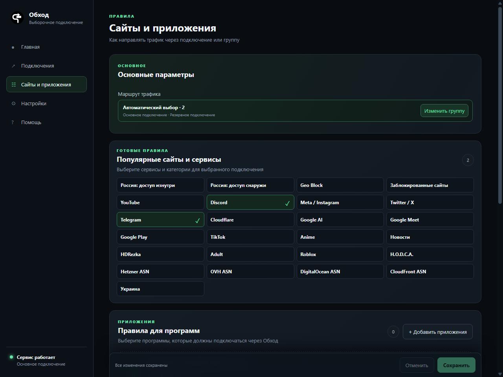
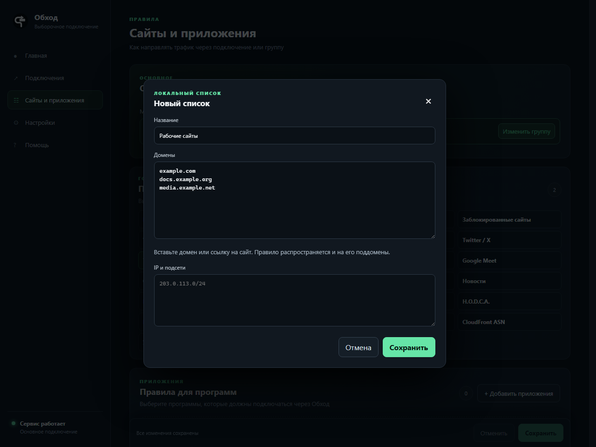
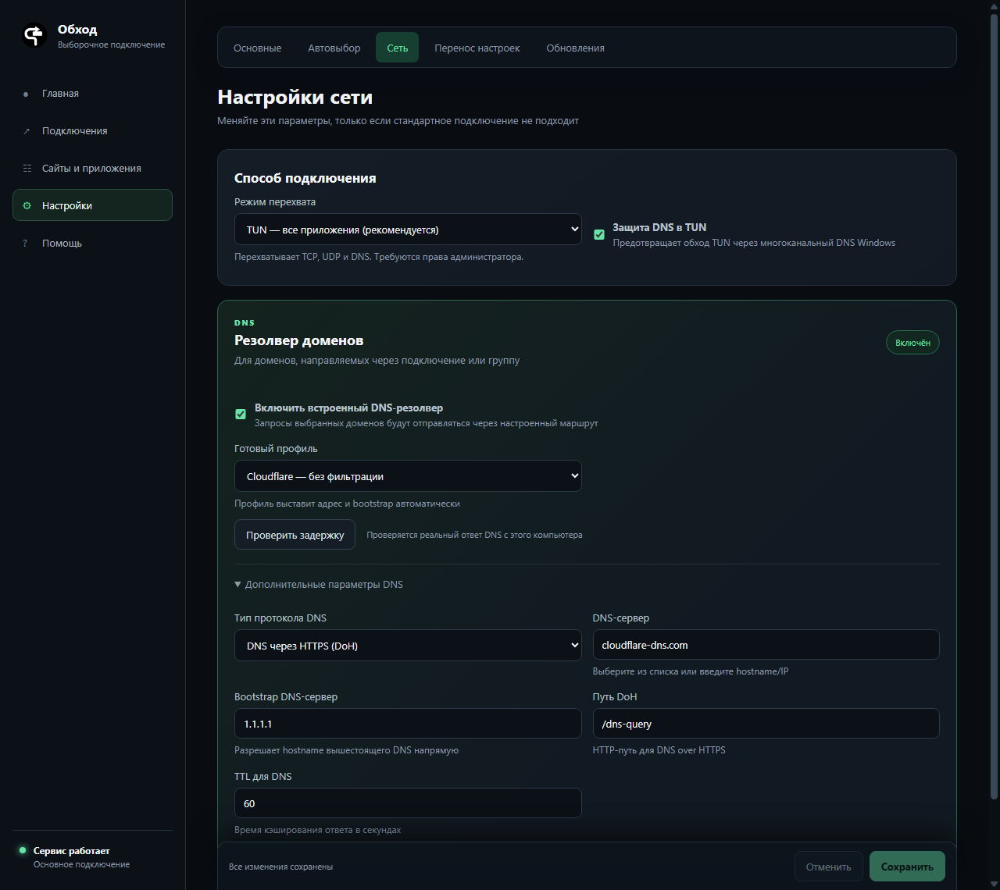
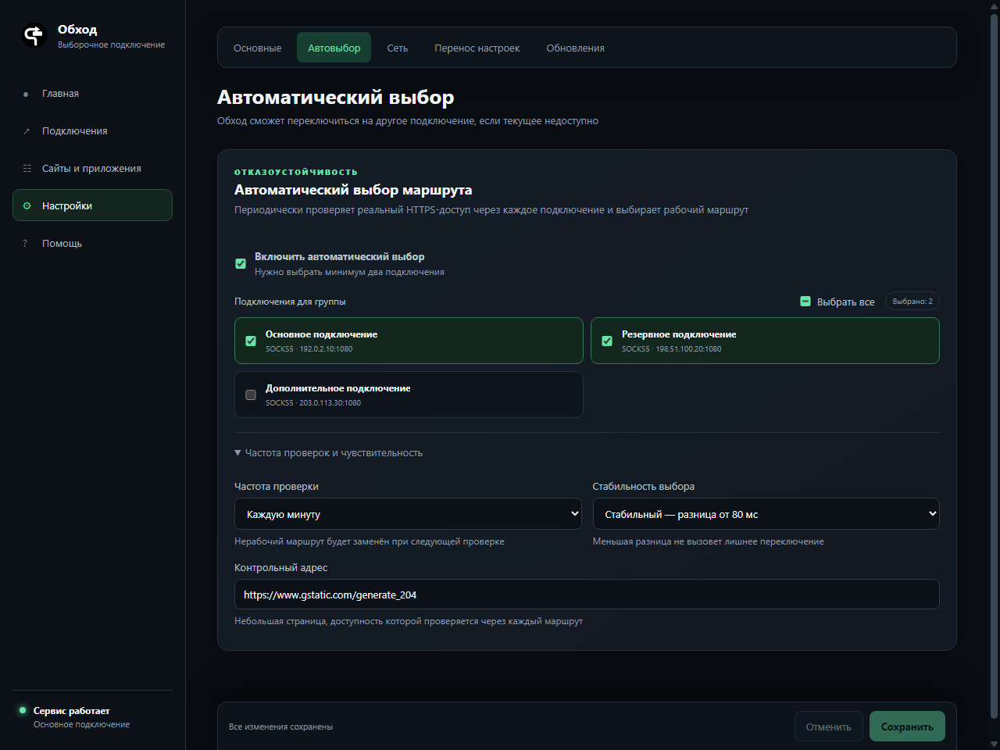
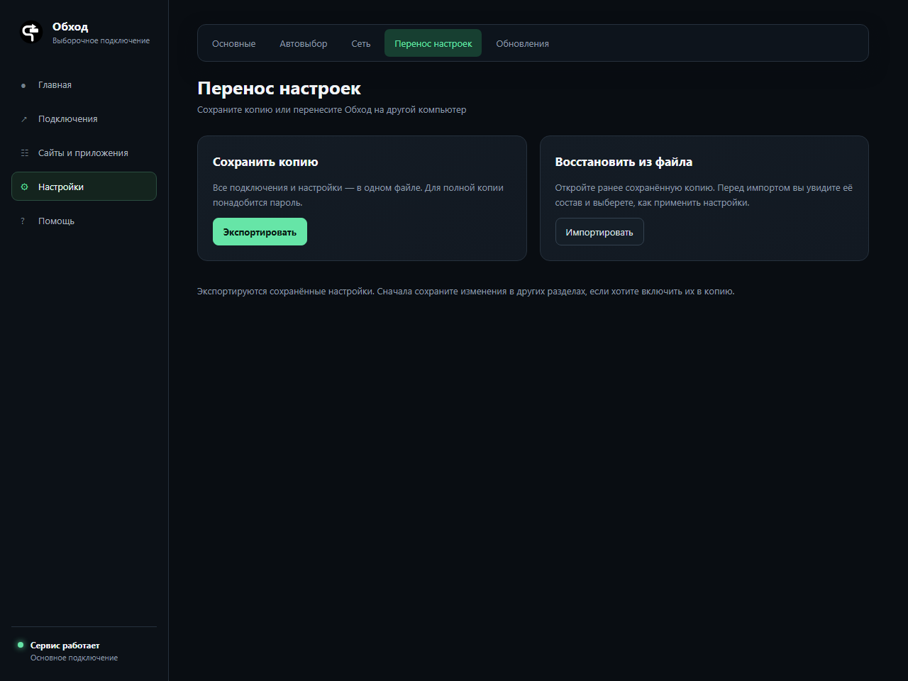
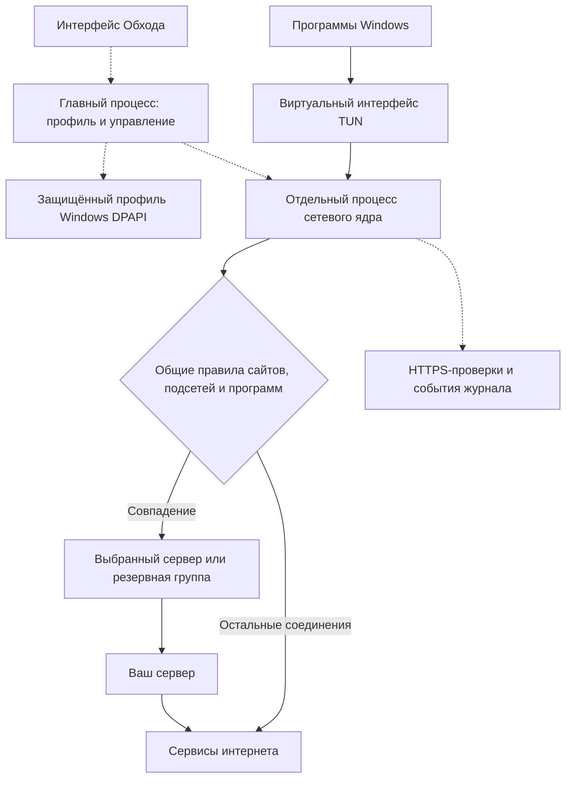

# Обход для Windows

[← Главная документации](../README.md) · [Скачать установщик](https://github.com/Ktoto59/obhod-releases/releases/latest)

Обход управляет выборочной маршрутизацией на компьютере: нужные сайты, подсети
и программы используют ваше подключение, остальной трафик идёт напрямую.
Подходит для подключения рабочих ресурсов через отдельный сервер, управления
правилами нескольких сервисов и резервирования маршрута.

Руководство соответствует интерфейсу **0.18.0**. Скриншоты сняты с настоящего
интерфейса на демонстрационных данных: указанные серверы и подписка не работают,
а IP и задержки показаны для примера.

## Содержание

- [Что потребуется](#что-потребуется)
- [Установка](#установка)
- [Первый запуск](#первый-запуск)
- [Подключения и импорт](#подключения-и-импорт)
- [Сайты, подсети и программы](#сайты-подсети-и-программы)
- [Режимы подключения](#режимы-подключения)
- [DNS](#dns)
- [Резервные подключения](#резервные-подключения)
- [Повседневное использование](#повседневное-использование)
- [Обновление](#обновление)
- [Резервная копия и перенос](#резервная-копия-и-перенос)
- [Диагностика и решение проблем](#диагностика-и-решение-проблем)
- [Как устроена работа приложения](#как-устроена-работа-приложения)
- [Удаление](#удаление)
- [Разработка](#разработка)

## Что потребуется

- Компьютер с 64-разрядной Windows 10/11 и доступом в интернет.
- Права администратора для запуска маршрутизации в TUN.
- Свои настройки подключения: `.conf` WireGuard/AmneziaWG, ссылка прокси
  или V2Ray-подписка. Получите их у провайдера либо администратора сервера.

Поддерживаются WireGuard, AmneziaWG, VLESS/Reality, Shadowsocks, Trojan,
Hysteria2, TUIC, AnyTLS, SOCKS5 и HTTP(S). Установка другого VPN-клиента сама
по себе не добавляет его конфигурацию в Обход.

## Установка

1. Откройте [релизы Windows](https://github.com/Ktoto59/obhod-releases/releases/latest).
2. В **Assets** скачайте `Obhod-Setup-<версия>.exe`, например `Obhod-Setup-0.18.0.exe`.
   Архивы исходников, лицензий, `latest.yml` и `.blockmap` для установки не нужны.
3. Запустите установщик, выберите каталог и завершите установку.
4. Откройте **Обход** из меню «Пуск» или с ярлыка. Подтвердите запрос Windows
   на повышение прав при запуске приложения.

Сетевое ядро входит в установщик: отдельно устанавливать sing-box не требуется.
Если в конкретном релизе доступна portable-сборка `Obhod-<версия>.exe`, её
можно запускать без мастера установки; файл `Setup` — обычный установщик.



## Первый запуск

Мастер состоит из трёх шагов: **Подключение → Правила → Проверка**.

1. Импортируйте подключение из `.conf` или ссылки. При необходимости выберите
   ручную настройку и заполните параметры, выданные администратором.
2. Оставьте предложенные наборы сайтов или настройте собственный выбор.
3. Нажмите **Проверить подключение**, затем **Проверить и включить**.

Мастер можно пройти повторно через **Помощь → Запустить мастер**.
Если знакомство пропущено, выполните те же действия в разделах
**Подключения** и **Сайты и приложения**, затем включите Обход на **Главной**.

## Подключения и импорт

Откройте **Подключения** в боковом меню.



### Файл WireGuard или AmneziaWG

1. Нажмите **Импорт .conf** и выберите файл, выданный провайдером.
2. Проверьте название, адрес сервера и протокол в редакторе.
3. Нажмите **Проверить**, чтобы проверить доступность через это подключение.
4. При ручном редактировании сохраните подключение кнопкой в редакторе.

Для AmneziaWG параметры маскировки берутся из файла. Меняйте их только по
настройкам сервера: произвольные значения нарушат совместимость.

### Одна ссылка

1. Нажмите **Вставить ссылку**.
2. Выберите **Одно подключение** и вставьте полную ссылку, например `vless://…`
   или `ss://…`, полученную от провайдера.
3. Нажмите **Импортировать**.

### V2Ray-подписка или список серверов

1. Нажмите **Вставить ссылку → Подписка V2Ray**.
2. Вставьте HTTPS-адрес подписки, список ссылок подключения или его Base64-представление.
3. Нажмите **Импортировать**. Серверы появятся отдельными карточками.



Повторяющиеся настройки пропускаются. URL подписки не сохраняется, поэтому
для получения новых серверов повторите импорт вручную. Это добавление серверов,
а не автоматическая синхронизация и удаление исчезнувших записей.
VMess и целые конфигурации клиентов JSON/YAML этим импортом не поддерживаются.

В режиме одного маршрута выберите **Основное подключение** на странице
**Сайты и приложения**. При включённом автовыборе трафиком управляет группа;
выбор одной карточки для редактирования не выключает автоматический режим.

## Сайты, подсети и программы

Откройте **Сайты и приложения**. Вверху видно, какое подключение или группа
используется всеми выбранными правилами.



### Свой список доменов

1. Нажмите **+ Добавить сайт** в области своих списков; при необходимости прокрутите страницу.
2. Задайте название, например «Рабочие сайты».
3. В поле **Домены** вставьте адреса, по одному в строке:

```text
example.com
docs.example.org
media.example.net
```

4. Нажмите **Сохранить** в окне списка.
5. Если нижняя панель показывает несохранённые изменения, нажмите **Сохранить** на странице.



Можно вставить полный URL: из `https://docs.example.org/page` будет взят
домен `docs.example.org`. Правило относится к домену и его поддоменам,
а не к отдельной странице. `*.example.com`, пути и порты для такого правила не нужны.
Указанные выше домены служат примерами — замените их нужными вам адресами.

### IP-адреса и подсети

Добавляйте их в отдельное поле **IP и подсети**, по одной записи в строке:

```text
203.0.113.10/32
198.51.100.0/24
```

`/32` обозначает один IPv4-адрес, `/24` — подсеть. Это демонстрационные диапазоны;
для работы укажите реальные адреса нужного ресурса. Правило IP может охватить
несколько сервисов, если они используют общий сервер или CDN.

### Готовые наборы и внешние списки

Отметьте сервисы в **Популярные сайты и сервисы**. Региональные наборы
взаимоисключающие; интерфейс отключает несовместимые сочетания. Большой набор
может уже включать отдельные сервисы.

В разделе внешних списков можно добавить URL и выбрать содержимое:
домены либо IP/подсети. Поддерживаются `.srs`, JSON формата rule-set sing-box
и обычные текстовые списки. В текстовом списке размещайте по одной записи
в строке; JSON другого приложения не становится совместимым только из-за расширения.
Частота обновления списков задаётся на этой же странице.

### Правила программ

1. В **Правила для программ** нажмите **+ Добавить приложение**.
2. Найдите программу среди установленных или запущенных, либо выберите её `.exe`.
3. Добавьте правило и сохраните изменения.

Правила программ работают в **TUN** и сопоставляются с путём процесса.
Если приложение обновилось и изменило путь к `.exe`, проверьте правило заново.
Для программы с отдельными фоновыми процессами может понадобиться несколько записей.

Кнопка **Отменить** возвращает несохранённые изменения страницы к сохранённым
параметрам. Сохранение новых правил при работающей маршрутизации применяет
конфигурацию и может прервать активные соединения.

## Режимы подключения

Откройте **Настройки → Сеть → Способ подключения**.

| Режим | Когда использовать | Что учитывается |
| --- | --- | --- |
| **TUN** | Общая выборочная маршрутизация ПК, включая UDP и правила программ | TCP, UDP и DNS; нужны права администратора |
| **Системный прокси Windows** | Приложения, использующие системную настройку прокси | Приложения, игнорирующие системный прокси, продолжат работать своим способом |
| **Только локальный прокси** | Ручная настройка конкретной программы | Укажите в ней HTTP/SOCKS-прокси `127.0.0.1` и порт из настроек Обхода |

По умолчанию локальный порт — `2080`. Даже в режиме прокси правила выбранных
сайтов определяют маршрут внутри ядра. Режим TUN перехватывает соединения
приложений, но не означает отправку всего интернета через сервер.

На время первичной проверки отключите другой VPN/TUN-клиент на ПК: иначе он
может перехватить маршрут раньше Обхода и исказить результат.

## DNS

В **Настройки → Сеть** находится блок встроенного DNS-резолвера.



1. Включите **Встроенный DNS-резолвер**, если хотите задать DNS выбранных доменов.
2. Выберите готовый профиль или свои настройки.
3. В **Дополнительные параметры DNS** доступны UDP, TCP, TLS или HTTPS,
   адрес сервера, bootstrap IP, путь DoH и TTL.
4. Нажмите **Проверить задержку**, затем сохраните настройки.

Bootstrap используется, чтобы узнать адрес DNS-сервера, заданного именем.
Для DoH обычно требуется путь `/dns-query`, но у провайдера он может быть другим.
Проверка задержки выполняется с этого ПК и не заменяет проверку всего маршрута.
Запросы выбранных доменов направляются через настроенное подключение;
остальные используют отдельный прямой DNS. Эти настройки не являются общей
системой фильтрации всех устройств домашней сети.

## Резервные подключения

Откройте **Настройки → Автовыбор**.



1. Импортируйте минимум два рабочих подключения.
2. Включите **Включить автоматический выбор**.
3. Отметьте серверы группы; **Выбрать все** отмечает или снимает все флажки.
4. При необходимости раскройте **Частота проверок и чувствительность**.
5. Сохраните настройки.

Проверяется HTTPS-доступ к контрольному адресу через подключения группы.
**Частота проверки** задаёт период тестов, а **Стабильность выбора** — допуск
разницы задержек: 80 мс уменьшает переключения из-за небольших колебаний.
Все серверы группы используют общие правила. Скорости не суммируются.

Чтобы работать только с одним сервером, **выключите автовыбор**, выберите
основное подключение и сохраните. При физическом отказе сервера уже установленный
звонок может оборваться: резерв обеспечивает другой маршрут для новых соединений.

## Повседневное использование

- **Включить/выключить:** большая кнопка на **Главной**. На ней отображается «ПУСК» или «СТОП».
- **Проверить маршрут:** на главной видны активный сервер и задержка контрольного HTTPS-запроса.
- **Изменить правила:** **Сайты и приложения → Сохранить**.
- **Автозапуск:** **Настройки → Основные → Запускать вместе с Windows**.
- **Автоматическое включение:** отдельно отметьте **Включать Обход при запуске**.
- **Журнал:** **Помощь → Открыть журнал**.

Показатель **Внешний IP системы** проверяется отдельно и кэшируется. При
выборочной маршрутизации он может отличаться от IP конкретного выбранного сайта.
Для проверки добавьте нужный сервис определения IP в правила, сохраните их
и откройте его заново. Уже существующее соединение браузера может сохранять прежний маршрут.

Закрытие окна сворачивает приложение в трей. Для полного завершения используйте
меню значка в трее. Штатная остановка завершает ядро и восстанавливает
управляемые приложением параметры системного прокси.

## Обновление

1. Сохраните изменения правил и при необходимости экспортируйте резервную копию.
2. Откройте **Настройки → Обновления** и нажмите кнопку проверки.
3. При наличии версии загрузите её и выполните установку через интерфейс.

Обновление также можно открыть из уведомления на главной. Автоматический поиск
версий и их загрузка — разные действия: загрузка начинается вручную.
Если встроенное обновление недоступно, скачайте новый `Obhod-Setup-<версия>.exe`
из официального канала и выполните установку поверх существующей версии.

## Резервная копия и перенос

Откройте **Настройки → Перенос настроек**.



- **Все подключения и настройки:** экспорт в `.obhod` с паролем минимум из 10 символов.
  Для восстановления потребуется этот пароль.
- **Только свои списки сайтов и готовые наборы:** перенос правил без подключений,
  внешних URL и путей программ; содержимое такого файла доступно для чтения.

При импорте сначала показывается состав копии. **Добавить** сохраняет текущие
настройки и дополняет их, **Заменить** заменяет выбранный состав профиля.
После переноса проверьте пути к программам и доступность подключений.
Автозапуск не переносится как обязательная настройка нового ПК.

Локальный профиль защищён Windows DPAPI. Простое копирование `profile.json`
на другой компьютер не заменяет экспорт `.obhod`.
Подробнее: [формат, ограничения и восстановление копии](docs/BACKUPS.md).

## Диагностика и решение проблем

Откройте **Помощь → Открыть журнал → Проверить DNS/маршрут**. Там же можно
скопировать или экспортировать отчёт. Подробную запись включайте в **Помощь**
на время проверки: она создаёт больше событий и может содержать сетевые адреса.
Перед публикацией отчёта проверьте его содержимое.

| Симптом | Что проверить |
| --- | --- |
| Подключение не запускается | Проверьте импортированные параметры, доступность сервера и результат кнопки «Проверить» |
| TUN не запускается | Права администратора и другой работающий VPN/TUN-клиент |
| Сайт остаётся на прямом маршруте | Сохранение правила, правильный домен, основной сервер/группа; перезапустите соединение сайта |
| Не работает только часть сайта | Добавьте его необходимые API/медиа-домены; у страницы может быть несколько независимых соединений |
| Программа не учитывает правило | TUN, правильный путь к `.exe` и используемые фоновые процессы |
| Веб работает, звонок — нет | Поддержку UDP сервером и протоколом; HTTPS-проверка не проверяет качество звонка |
| DNS не отвечает | Доступность DNS, корректность bootstrap, протокола и пути DoH |
| Слишком часто меняется сервер | Уменьшите группу, используйте допуск 80 мс, проверьте стабильность каждого сервера отдельно |

При отказе всех серверов группы выбранные соединения не должны автоматически
перенаправляться напрямую внутри работающего ядра. Полноценный системный
kill switch при аварии ядра не реализован. Подробности:
[поведение восстановления и границы проверок](docs/RESILIENCE.md).

## Как устроена работа приложения

Сплошные стрелки показывают путь трафика; пунктир — управление.
На схеме показан режим TUN.



В прокси-режимах вместо TUN программы подключаются к локальному HTTP/SOCKS-порту.
Интерфейс редактирует профиль и управляет ядром; передачу трафика выполняет ядро.
Windows- и OpenWrt-профили не синхронизируются автоматически.

## Удаление

1. Выключите маршрутизацию и полностью завершите Обход через трей.
2. В Windows откройте **Параметры → Приложения**, найдите Обход и удалите его.
3. При необходимости заранее экспортируйте `.obhod`.

Удаление установщика не удаляет локальные пользовательские данные автоматически.
Для portable-варианта после полного завершения приложения можно удалить его `.exe`.

## Разработка

Из корня репозитория:

```powershell
npm ci
npm test
npm start
```

Для запуска маршрутизации подготовьте `sing-box.exe` по
[инструкции](docs/BUILDING_RUNTIME.md) и поместите в `windows/runtime/`.
Бинарник не хранится в Git. Ожидаемые версия и SHA-256 указаны в
[`legal/runtime-components.json`](../legal/runtime-components.json).

```powershell
npm run license:check
npm run test:ui
npm run build
npm run build:installer
```

Сборки появляются в корневой папке `release/`. Общая логика — в
[`shared/`](../shared/), главный процесс — в `src/main/`, интерфейс — в `src/renderer/`.
Иллюстрации создаются [отдельным изолированным сценарием](../docs/images/README.md).

### Публикация

Сопровождающий публикует из чистого checkout командой `./scripts/publish-release.ps1`.
Скрипт проверяет тесты и лицензии, собирает установщик и прикладывает исходники
GPL-ядра. Нужны GitHub CLI с доступом к репозиторию релизов, GitHub noreply email
и ключ подписи коммитов. Путь к публичному ключу задаётся через `OBHOD_SIGNING_KEY`.
Ключи и токены остаются в локальной среде сопровождающего.
